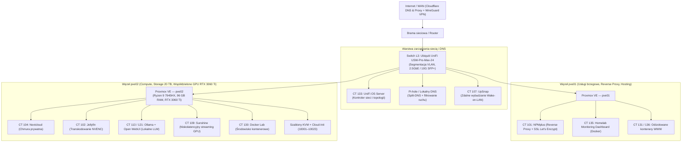

# Homelab Infrastructure & Proxmox VE Automation (`Piwniczak`)

Dokumentacja domowego środowiska serwerowego (Homelab) opartego na wielowęzłowym klastrze **Proxmox VE 9**, zarządzalnej infrastrukturze sieciowej **Ubiquiti UniFi** oraz autorskich skryptach monitoringu sprzętowego (SMART, dGPU/iGPU, temperatury CPU) i szablonach **cloud-init**.

---

## Spis treści
1. [Architektura i topologia sieci](#1-architektura-i-topologia-sieci)
2. [Specyfikacja sprzętowa węzłów](#2-specyfikacja-sprzętowa-węzłów)
3. [Utrzymywane usługi (LXC / KVM / Docker)](#3-utrzymywane-usługi-lxc--kvm--docker)
4. [Autorskie mikroserwisy monitoringu i tuning sprzętowy](#4-autorskie-mikroserwisy-monitoringu-i-tuning-sprzętowy)
5. [Szablony maszyn wirtualnych i automatyzacja `cloud-init`](#5-szablony-maszyn-wirtualnych-i-automatyzacja-cloud-init)
6. [Struktura repozytorium](#6-struktura-repozytorium)

---

## 1. Architektura i topologia sieci

Środowisko jest podzielone na warstwę sieciową zarządzaną centralnie przez **UniFi OS Server** (ze switchem L3 **Ubiquiti USW-Pro-Max-24** oraz segmentacją VLAN) oraz klaster wirtualizacji **Proxmox VE** obsługujący odizolowane kontenery LXC i maszyny wirtualne KVM/QEMU.



---

## 2. Specyfikacja sprzętowa węzłów

| Element | Węzeł `pve02` (Compute / Storage / GPU) | Węzeł `pve01` (Core Services / Edge) | Sieć (Switching) |
| :--- | :--- | :--- | :--- |
| **Procesor** | AMD Ryzen 9 7945HX (16C / 32T, Zen 4) | Jednostka x86_64 Low-Power | **Ubiquiti UniFi USW-Pro-Max-24** |
| **Pamięć RAM** | 96 GB DDR5 | 8 GB DDR4 | Zarządzalny L3, 24x RJ45 (1G/2.5G) + 2x 10G SFP+ |
| **Karta graficzna** | NVIDIA GeForce RTX 3060 Ti (8 GB VRAM) + AMD Radeon 610M (iGPU) | Zintegrowana | Segmentacja VLAN, monitoring portów przez API |
| **Przestrzeń dyskowa** | 1.9 TB NVMe (Kioxia) + 16.4 TB HDD (WDC) + 1.8 TB HDD | 500 GB NVMe (Samsung) | — |
| **System / Hypervisor** | Proxmox VE 9.1 (Linux 6.x) | Proxmox VE 9.1 (Linux 6.x) | Kontroler: `unifi-os-server` (LXC) |

---

## 3. Utrzymywane usługi (LXC / KVM / Docker)

* **Infrastruktura i sieć:**
  * **Nginx Proxy Manager / NPMplus** – brama reverse proxy obsługująca ruch HTTP/HTTPS, automatyczne odnawianie certyfikatów TLS (Let's Encrypt / ACME) oraz listy kontroli dostępu.
  * **UniFi OS Server** – lokalny kontroler zarządzający przełącznikiem `USW-Pro-Max-24`, profilami portów i sieciami VLAN.
  * **UpSnap (Wake-on-LAN)** – wybudzanie węzłów i stacji roboczych pakietami *Magic Packet* oraz monitoring dostępności hostów (ICMP/TCP).
  * **Pi-hole & WireGuard** – lokalny resolver DNS z blokowaniem niechcianych domen oraz bezpieczny dostęp zdalny do sieci wewnętrznej.
* **Przechowywanie danych, AI i multimedia (z akceleracją GPU w LXC):**
  * **Nextcloud** – prywatna chmura plików i synchronizacja danych dla domowników.
  * **Ollama + Open WebUI** – lokalny serwer modeli językowych (LLM) korzystający z akceleracji CUDA na karcie RTX 3060 Ti.
  * **Jellyfin** – serwer multimedialny ze sprzętowym transkodowaniem wideo (NVENC).
* **Izolowany hosting WWW i bazy danych:**
  * Utrzymanie stron internetowych dla znajomych w odizolowanych kontenerach LXC z bazami danych **MySQL / MariaDB** i **PostgreSQL**.

---

## 4. Autorskie mikroserwisy monitoringu i tuning sprzętowy

Na hostach Proxmox VE działają lekkie demony systemowe (`systemd`) napisane w Pythonie i Bashu, które wystawiają metryki sprzętowe po HTTP JSON (porty `9500–9503`) na potrzeby dashboardu oraz alertów:

### Monitoring zdrowia dysków i temperatur (`scripts/monitoring/`)
* **[`disk-health-service.py`](scripts/monitoring/disk-health-service.py)** (port `9502`) – mikroserwis odpytujący `smartctl` na wszystkich wykrytych nośnikach (NVMe, SSD, HDD). Analizuje krytyczne atrybuty S.M.A.R.T. (`Reallocated_Sector_Ct`, `Current_Pending_Sector`, `Offline_Uncorrectable`, błędy CRC kabli SATA, temperaturę oraz zużycie NAND `wear_pct`) i klasyfikuje stan każdego dysku jako `ok`, `warning` lub `critical`.
* **[`smart-daily-check.sh`](scripts/monitoring/smart-daily-check.sh)** – skrypt uruchamiający codzienne krótkie testy własne (`smartctl -t short`) na wszystkich dyskach z automatyczną rotacją logów w `/var/log/smart-daily.log`.
* **[`cpu-temp-monitor.py`](scripts/monitoring/cpu-temp-monitor.py)** (port `9501`) – odczyt temperatur procesora z `/sys/class/thermal` oraz `/sys/class/hwmon` (obsługa `k10temp` z podziałem na `Tctl` i matryce `CCD` dla AMD Ryzen oraz `coretemp` dla Intel).
* **[`gpu-monitor.py`](scripts/monitoring/gpu-monitor.py)** (port `9500`) oraz **[`igpu-monitor.py`](scripts/monitoring/igpu-monitor.py)** (port `9503`) – eksporterzy parametrów karty NVIDIA RTX 3060 Ti (`nvidia-smi`: utylizacja, VRAM, pobór mocy, obroty wentylatora) oraz zintegrowanego układu AMD Radeon (`sysfs` / `amdgpu`: `gpu_busy_percent`, taktowanie `pp_dpm_sclk`, moc i VRAM).

### Współdzielenie GPU w LXC i optymalizacja opóźnień (`scripts/hardware-tuning/` & `systemd/`)
Karta **RTX 3060 Ti** nie jest zamknięta w pojedynczej maszynie wirtualnej (PCIe passthrough), lecz współdzielona bezpośrednio pomiędzy wieloma kontenerami LXC (`Ollama`, `Jellyfin`, `Sunshine`) poprzez mapowanie urządzeń `/dev/nvidia*` oraz `/dev/nvidia-caps/*`.
* **[`gpu-cleanup-hook.sh`](scripts/hardware-tuning/gpu-cleanup-hook.sh)** – hookscript Proxmoxa (`pct set <VMID> -hookscript local:snippets/gpu-cleanup-hook.sh`) wykonywany w fazach `pre-start`, `post-start`, `pre-stop` oraz `post-stop`:
  * ładuje moduły `nvidia-modprobe`, włącza tryb *Persistence Mode* i nadaje uprawnienia do urządzeń `/dev/nvidia*` wewnątrz kontenera,
  * po zatrzymaniu kontenera wykrywa i zamyka osierocone procesy blokujące pamięć VRAM (`fuser -k /dev/nvidia*`) oraz czyści bufory jądra.
* **[`nvidia-idle-fix.service`](systemd/nvidia-idle-fix.service)** – jednostka `systemd` rozwiązująca problem utknięcia bezgłowej (headless) karty NVIDIA w stanie wysokiej mocy `P0` po starcie hosta (wymusza zejście do stanu spoczynkowego `P8` i niski pobór prądu w idle).
* **[`streaming-cpu-perf.sh`](scripts/hardware-tuning/streaming-cpu-perf.sh)** – skrypt przypinający zarządcę `performance` oraz wyłączający głębokie stany uśpienia `C-state` na wybranych rdzeniach fizycznych na czas zadań wymagających niskiego opóźnienia.
* **[`disable-nic-offload-nic0.service`](systemd/disable-nic-offload-nic0.service)** – obejście problemu zawieszania karty sieciowej Intel `e1000e` pod dużym obciążeniem poprzez wyłączenie sprzętowego offloadingu (`ethtool -K nic0 gso off gro off tso off...`).

---

## 5. Szablony maszyn wirtualnych i automatyzacja `cloud-init`

W katalogu [`cloud-init/`](cloud-init/) znajdują się pliki konfiguracyjne (przechowywane na Proxmoxie w `/var/lib/vz/snippets/`), które służą do bezobsługowego wdrażania maszyn wirtualnych z obrazów bazowych Ubuntu / Debian (Golden Images):

| Szablon `cloud-init` | Instalowany stos i konfiguracja |
| :--- | :--- |
| [`install-agent.yaml`](cloud-init/install-agent.yaml) | Bazowa inicjalizacja: instalacja i uruchomienie `qemu-guest-agent` do komunikacji hosta Proxmox z VM |
| [`docker.yml`](cloud-init/docker.yml) | Silnik `docker.io` + `docker-compose`, automatyczny start demona i uprawnienia grupy |
| [`nginx.yml`](cloud-init/nginx.yml) / [`haproxy.yml`](cloud-init/haproxy.yml) | Serwer HTTP / Reverse Proxy (`nginx`) lub Load Balancer (`haproxy`) |
| [`lamp.yml`](cloud-init/lamp.yml) | Pełny stos LAMP (`apache2`, `mysql-server`, `php`, `php-mysql`) |
| [`mysql.yml`](cloud-init/mysql.yml) / [`postgresql.yml`](cloud-init/postgresql.yml) / [`redis.yml`](cloud-init/redis.yml) | Gotowe instancje bazodanowe (MySQL, PostgreSQL + `contrib`, Redis) |
| [`k8s-node.yml`](cloud-init/k8s-node.yml) | Przygotowanie węzła Kubernetes (`kubelet`, `kubeadm`, `kubectl` z oficjalnego repozytorium `pkgs.k8s.io`) |
| [`dns-dhcp.yml`](cloud-init/dns-dhcp.yml) | Lokalny serwer nazw i adresacji (`bind9`, `bind9utils`, `isc-dhcp-server`) |
| [`python-dev.yml`](cloud-init/python-dev.yml) / [`nodejs.yml`](cloud-init/nodejs.yml) / [`vscode-dev.yml`](cloud-init/vscode-dev.yml) | Środowiska uruchomieniowe i deweloperskie (Python 3 + `venv`, Node.js + `npm`, `code-server` w przeglądarce) |

Przykładowe podpięcie szablonu do maszyny wirtualnej w Proxmox VE:
```bash
qm clone 10001 205 --name vm-docker-lab --full
qm set 205 --cicustom "user=local:snippets/docker.yml"
qm set 205 --ipconfig0 ip=dhcp
qm start 205
```

---

## 6. Struktura repozytorium

```text
homelab/
├── README.md
├── cloud-init/                  # Snippety cloud-init (/var/lib/vz/snippets/)
│   ├── dns-dhcp.yml
│   ├── docker.yml
│   ├── haproxy.yml
│   ├── install-agent.yaml
│   ├── k8s-node.yml
│   ├── lamp.yml
│   ├── mysql.yml
│   ├── nginx.yml
│   ├── nodejs.yml
│   ├── postgresql.yml
│   ├── python-dev.yml
│   ├── redis.yml
│   └── vscode-dev.yml
├── scripts/
│   ├── hardware-tuning/         # Skrypty optymalizacji GPU LXC i CPU
│   │   ├── gpu-cleanup-hook.sh
│   │   └── streaming-cpu-perf.sh
│   └── monitoring/              # Mikroserwisy HTTP JSON (SMART, CPU, dGPU, iGPU)
│       ├── cpu-temp-monitor.py
│       ├── disk-health-service.py
│       ├── gpu-monitor.py
│       ├── igpu-monitor.py
│       └── smart-daily-check.sh
└── systemd/                     # Jednostki systemd dla hostów Proxmox VE
    ├── cpu-temp-monitor.service
    ├── disable-nic-offload-nic0.service
    ├── disk-health-service.service
    ├── gpu-monitor.service
    ├── igpu-monitor.service
    ├── nvidia-idle-fix.service
    └── streaming-cpu-perf.service
```
